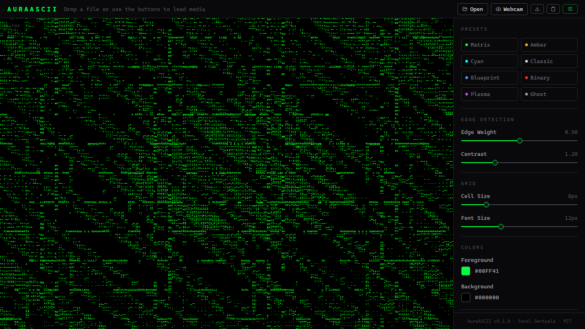
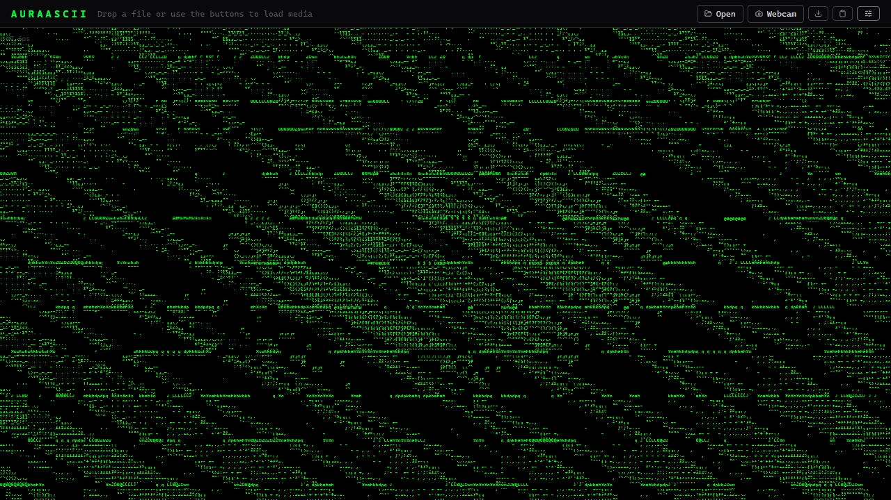
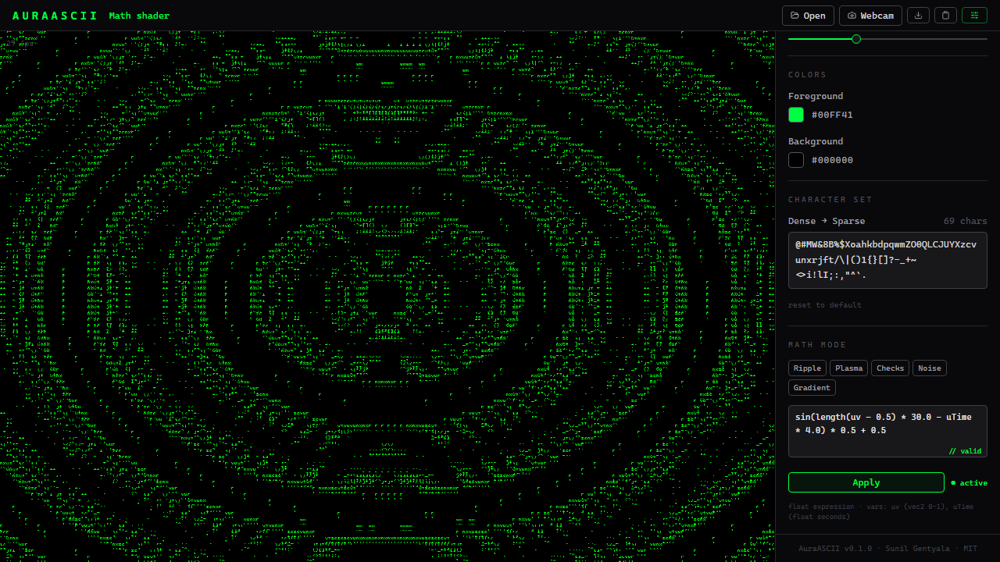

# AuraASCII

> High-performance, edge-aware ASCII and generative typographic media tool powered by WebGL shaders.

[](https://sunilgentyala.github.io/auraascii/)
[](LICENSE)
[](https://www.typescriptlang.org/)
[](https://react.dev/)
[](https://threejs.org/)
[](https://vitejs.dev/)

AuraASCII converts images, GIFs, live video streams, and procedural GLSL math expressions into edge-aware, high-performance ASCII and generative typographic art. Unlike DOM-based ASCII converters, AuraASCII runs entirely on the GPU via a two-pass GLSL pipeline, achieving a stable 60 FPS even at high character densities.

**[Try the live demo](https://sunilgentyala.github.io/auraascii/)**

---

## Features

- **Real-time media processing** - Images (PNG, JPG, WebP, AVIF), animated GIFs, MP4/WebM video, and live webcam streams
- **Edge-aware character mapping** - Sobel filter runs as a GPU fragment shader; character selection follows the actual contour geometry of subjects
- **Math shader mode** - Write custom GLSL distance functions and see them rendered live in typographic form, executed inside a null-origin sandboxed Web Worker
- **60 FPS rendering** - Two-pass WebGL2 pipeline with GlyphAtlas pre-rendering; zero per-frame CPU text calls
- **8 built-in presets** - Matrix, Amber, Cyan, Classic, Blueprint, Binary, Plasma, Ghost; fully customizable colors and charset
- **PNG export and clipboard copy** - Download the current frame as PNG or copy the raw ASCII text grid
- **Fully client-side** - Zero server calls; all processing happens in the browser

---

## Screenshots

| Full UI | Full Canvas | Math Shader Mode |
|---|---|---|
|  |  |  |

*Left: default debug texture with control panel open. Center: panel collapsed, wall-to-wall ASCII. Right: live Ripple GLSL expression (`sin(length(uv - 0.5) * 30.0 - uTime * 4.0) * 0.5 + 0.5`) rendered in real time.*

---

## Architecture

```
┌─────────────────────────────────────────────────────────────┐
│                        React UI Layer                        │
│  CanvasHost   ControlPanel   PresetSelector   ShaderEditor  │
└────────────────────────┬────────────────────────────────────┘
                         │ media texture + config
                         ▼
┌─────────────────────────────────────────────────────────────┐
│                    AsciiRenderer (WebGL2)                    │
│                                                             │
│  ┌──────────────────────┐   ┌──────────────────────────┐   │
│  │   Pass 1: EdgeFBO    │   │   Pass 2: ASCII Screen   │   │
│  │                      │   │                          │   │
│  │  Sobel 3x3 kernel    │──▶│  Glyph Atlas sampler     │   │
│  │  fragment shader     │   │  intensity = mix(lum,    │   │
│  │  out: magnitude,     │   │  edgeMag, edgeWeight)    │   │
│  │  angle, luminance    │   │  maps to charset index   │   │
│  └──────────────────────┘   └──────────────────────────┘   │
│                                                             │
│  GlyphAtlas  (HTMLCanvas pre-render → single GPU texture)   │
│  Sources: ImageSource | GifSource | VideoSource | MathSource│
└─────────────────────────────────────────────────────────────┘
                         │
          ┌──────────────┴──────────────┐
          │   ?worker&inline Worker     │
          │   (blob URL, null origin)   │
          │   GLSL expression validator │
          └─────────────────────────────┘
```

### Two-Pass GPU Pipeline

**Pass 1 - Edge Detection FBO**
The source media texture is sampled by a Sobel convolution fragment shader using a 3x3 BT.709 luminance kernel. Gradient magnitude, angle, and centre luminance are written to a HalfFloat FBO texture. No CPU readback.

**Pass 2 - Character Selection**
A full-screen quad shader reads the EdgeFBO. Each character cell maps to one grid position in a virtual ASCII grid. The shader blends edge intensity with luminance to select an index into the **Glyph Atlas** - a single 2D texture pre-rendered with all charset characters in a fixed monospace grid. The chosen glyph texel is composited against the background color.

**Glyph Atlas**
Built at startup on an HTMLCanvasElement: all printable characters are rendered white-on-black into a power-of-two texture (e.g., 512x512). Uploaded once as a `THREE.CanvasTexture`. Zero per-frame CPU text calls.

---

## Security Design

AuraASCII is built Secure by Design. The threat model addresses malicious media files, path traversal in filenames, and arbitrary user-supplied GLSL code.

| Threat | Mitigation |
|---|---|
| Malicious metadata in uploaded media (EXIF) | Files treated as opaque binary; no EXIF/metadata parsing at any layer |
| Path traversal via filename | `validateMediaFile()` rejects names containing `/`, `\`, `:`, `<`, `>`, `"`, `|`, `?`, `*`, or null bytes |
| MIME spoofing | Explicit allowlist (`image/png`, `image/jpeg`, `image/webp`, `image/avif`, `image/gif`, `video/mp4`, `video/webm`); SVG excluded to prevent embedded script execution |
| Oversized uploads | Hard byte caps: 50 MB for images/GIFs, 500 MB for video |
| Malicious GLSL in math shader mode | Expression validated in a null-origin `?worker&inline` Worker (blob URL) with keyword blocklist; no access to `window`, `document`, `localStorage`, or cookies |
| Blob URL leakage | All blob URLs revoked immediately after texture upload in `onLoad` callback |
| XSS | CSP meta tag with `script-src 'self'`; no `innerHTML` or `dangerouslySetInnerHTML` |
| Supply chain | All dependencies pinned to exact versions; `npm audit --audit-level=moderate` in CI |

### Content Security Policy

```
default-src 'none';
script-src 'self';
worker-src 'self' blob:;
style-src 'self' 'unsafe-inline';
img-src 'self' blob: data:;
media-src 'self' blob:;
connect-src 'none';
frame-src 'none';
object-src 'none';
base-uri 'self';
form-action 'none';
upgrade-insecure-requests
```

`'unsafe-eval'` is intentionally absent. `gl.compileShader()` is a native GPU API and is unaffected by this restriction.

---

## Installation

**Prerequisites:** Node.js >= 20, npm >= 10

```bash
git clone https://github.com/sunilgentyala/auraascii.git
cd auraascii
npm ci
npm audit --audit-level=moderate
npm run dev
```

Opens the Vite dev server at `http://localhost:5173`. The WebGL canvas renders a debug test card on startup. Drop any supported media file onto the canvas to begin.

---

## Development

```bash
npm run dev        # Vite dev server with HMR
npm run typecheck  # TypeScript strict-mode check (no emit)
npm run lint       # ESLint with TypeScript rules
npm run build      # Production build to dist/
npm run preview    # Serve dist/ locally to verify
```

---

## Roadmap

| Phase | Milestone | Status |
|---|---|---|
| 1 | Repository scaffolding, license, Vite config | Complete |
| 2 | WebGL2 engine: GlyphAtlas, EdgeFBO, CharFBO, GLSL shaders | Complete |
| 3 | Media sources: Image, GIF, MP4/WebM, Webcam, MathSource | Complete |
| 4 | React UI: ControlPanel, PresetSelector, CanvasHost, ShaderEditor | Complete |
| 5 | Math shader mode with null-origin sandboxed Worker | Complete |
| 6 | PNG export, raw ASCII clipboard copy, FPS overlay | Complete |
| 7 | Visual node-graph editor for shader composition | Planned |

---

## Credits

**Author:** Sunil Gentyala
**GitHub:** [github.com/sunilgentyala](https://github.com/sunilgentyala)
**IEEE:** sunil.gentyala@ieee.org

---

## License

[MIT](LICENSE) - Copyright (c) 2026 Sunil Gentyala
